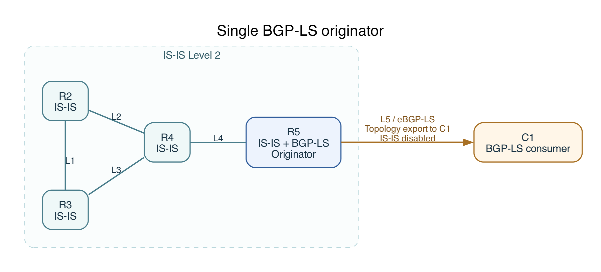

# BGP-LS network examples

The [single-originator lab](single-originator/topo1.clab.yaml) uses FRR and
containerlab to export an IS-IS topology through BGP-LS and observe updates.

## Single-originator topology



R2–R5 run IS-IS Level 2. R5 exports its IS-IS Traffic Engineering Database (TED)
through zebra to bgpd, then advertises BGP-LS routes to C1.

| Link | Endpoint A | Endpoint B |
| --- | --- | --- |
| L1 | R2 `eth1`: `10.2.0.1/32` | R3 `eth1`: `10.3.0.1/32` |
| L2 | R2 `eth2`: `10.2.0.2/32` | R4 `eth1`: `10.4.0.1/32` |
| L3 | R3 `eth2`: `10.3.0.2/32` | R4 `eth2`: `10.4.0.2/32` |
| L4 | R4 `eth3`: `10.4.0.3/32` | R5 `eth1`: `10.5.0.1/32` |
| L5 | R5 `eth2`: `192.0.2.1/30` | C1 `eth1`: `192.0.2.2/30` |

## Bring up the lab

Use a Linux host or VM with Docker access, Python 3, and containerlab with
[`frr` support](https://containerlab.dev/manual/kinds/frr/).

From the repository root:

```bash
cd examples/containerlab/bgp-ls
containerlab deploy -t single-originator/topo1.clab.yaml
```

Run all remaining commands from this directory.

## Observe R5's BGP-LS RIB

Once routing has converged, print R5's complete BGP-LS RIB:

```bash
python3 single-originator-demo.py --observe-r5
```

Expect **20 BGP-LS records (NLRIs): 4 routers, 8 directed links, and 8 prefixes**.
Each IS-IS link has a record for each direction. C1 receives the same records.

To inspect attributes such as metrics and bandwidth, use JSON output:

```bash
docker exec -e VTYSH_PAGER=cat clab-topo1-r5 vtysh -c 'show bgp link-state link-state json'
```

Replace `r5` with `c1` to inspect C1's received RIB. These commands also work
after any use case.

## Use cases

**The following are independent use cases. Start each case from a freshly deployed lab:**

```bash
containerlab destroy -t single-originator/topo1.clab.yaml --cleanup
containerlab deploy -t single-originator/topo1.clab.yaml
```

The [Python runner](single-originator-demo.py) checks the initial routing state,
applies the change, and verifies the result on R5 and C1. It leaves the lab
running for inspection.

### 1. Advertise a prefix through R2

Add a simulated LAN, `192.168.20.0/24`, on R2. After convergence, the prefix
appears in R5's BGP-LS RIB.

```bash
python3 single-originator-demo.py --test-advertise-prefix
```

### 2. Change an IS-IS metric

Raise R2→R3's IS-IS cost from 20 to 35. The link and R2's interface-prefix
metrics change; the reverse direction is unchanged.

```bash
python3 single-originator-demo.py --test-change-metric
```

### 3. Change advertised TE bandwidth

```bash
python3 single-originator-demo.py --test-change-te-bandwidth
```

### 4. Change a TE router ID

Change R3's TE router ID. Its node attribute changes while its IS-IS identity
and remain.

```bash
python3 single-originator-demo.py --test-change-router-id
```

### 5. Shut down the R2–R4 link

Disable both ends of R2–R4. Its two directed link records and two interface
prefix records disappear. R2 stays connected through R3.

```bash
python3 single-originator-demo.py --test-shutdown-interface
```

### 6. Shut down and restore the R2–R4 link

Shutdown and recovery, returning to the original BGP-LS RIB state.

```bash
python3 single-originator-demo.py --test-restore-interface
```

## Destroy the lab

```bash
containerlab destroy -t single-originator/topo1.clab.yaml --cleanup
```
